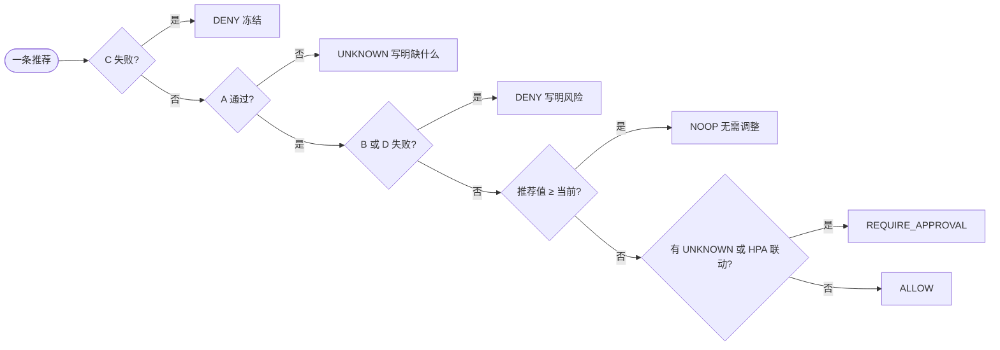
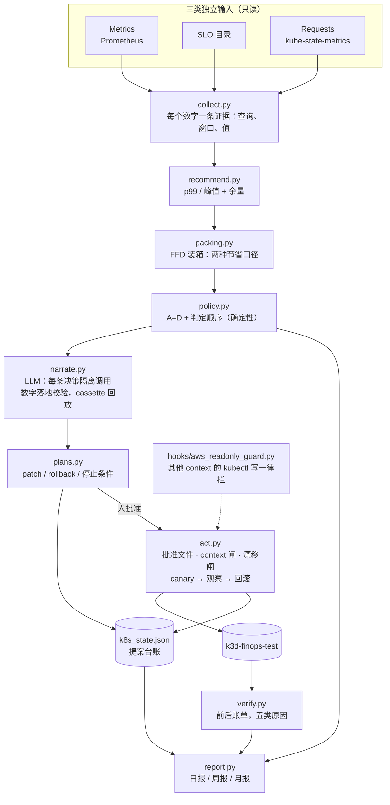

# SLO-aware FinOps Agent：以 SLO 为硬约束的成本优化 agent

在服务 SLO、容量安全和变更策略的约束下，持续发现、验证并兑现可归因的云成本节省。主线只做一件事：K8s workload 的 CPU/Memory requests。成本来自 AWS 节点价格，所以它仍然是 AWS FinOps，只是做深一项，不铺开。

它同时是一份用 spec、评估和护栏构建 LLM agent 的完整样例。

## 核心原则：三者不能互相替代

- **Metrics** 描述资源实际发生了什么。
- **SLO** 描述业务允许发生什么。
- **Requests** 描述调度器应为工作负载预留多少资源。

平均利用率低不等于可以降配；SLO 现在达标也不等于容量安全。agent 对每条候选变更分别检查四个条件：A 数据足够、B 资源余量、C 服务健康、D 可恢复。每个条件给出 PASS、FAIL 或 UNKNOWN，再由确定性的策略引擎判 ALLOW / REQUIRE_APPROVAL / DENY / UNKNOWN。缺数据就是 UNKNOWN，永远不当成通过；LLM 只负责解释和写提案，不参与判定。完整契约见 [`openspec/changes/c0027-slo-aware-mainline/specs/k8s-mainline/spec.md`](openspec/changes/c0027-slo-aware-mainline/specs/k8s-mainline/spec.md)。

## AWS 已经做了什么，这里补什么

Cost Optimization Hub 和 Compute Optimizer 已经能找出闲置和过配，也能估出潜在节省。这里不和它们比谁算规格更准，补的是三样东西：

- **额外的上下文**：服务的 SLO、错误预算、批任务窗口、HPA 联动、节点装箱。
- **专门的决策逻辑**：什么时候能动，什么时候必须拒绝，缺什么数据才能判。
- **可验证的执行闭环**：人批准之后，只在本地 k3d 集群上 canary 执行，命中停止条件就回滚；执行后核对节点数是否真的降了，requests 降了不等于省了钱。

## 传统降配流程和这个 agent 差在哪

一个 SRE 手工做 requests 降配，通常是六步。agent 没有发明新的方法论，它把这六步里能写成规则的部分写成代码，把「讲给人听」交给模型，把执行权留给人：

```
传统：  归属 ──> 观察 ──> 分析 ──> 算账 ──> 执行 ──> 核实
agent： 取数 ──> 事实卡 ──> 候选值 + 装箱 ──> 四个条件 A–D ──> 判定 ──> LLM 解释 ──> 人批准 ──> canary 执行 / 回滚 ──> 账单核实
        (PromQL)  (每个数带证据)  (算多少、省多少)  (数据/余量/健康/回滚)  (代码)   (只解释)              (停止条件)         (前后节点小时)
```

| 传统步骤 | 手工怎么做 | agent 里对应什么 | 谁做 | 变了什么 |
|---|---|---|---|---|
| 1. 归属 | 打 tag，按集群、团队、workload 分 | 不做；前提是指标已带 workload 标签 | 前置条件 | 没变 |
| 2. 观察 | 看大盘，按二八原则挑最贵的几个 | 取数：每天对所有 workload 跑同一组 PromQL | 代码 | 不靠人挑，覆盖全部；每个数编号成证据 |
| 3. 分析 | 拉 14 天用量，CPU 看 p99、内存看峰值；SLO、throttling、OOM 凭经验看 | 候选值（CPU p99 × 1.3，内存峰值 × 1.2）+ 四个条件 + 六步判定顺序 | 代码 | 经验变成规则：SLO 和错误预算是前置条件，数据不够判 UNKNOWN，内存看趋势，HPA 联动交给人 |
| 4. 算账 | 常常跳过，报账面释放的预留 | 装箱模拟，两种口径分开报 | 代码 | 节点少不了一台，就报 0 |
| — 说服负责人 | 人写工单、发消息解释 | 每条决策一次隔离调用，写解释、提案和「什么会改变判定」 | **LLM** | 唯一交给模型的一格；数字必须在证据里找得到，判定不许被改 |
| 5. 执行 | 手动改，回滚靠人记得 | 批准文件 + context + 现场状态三道闸，canary，命中停止条件自动回滚并验证 | 人批准，代码执行 | 回滚不靠记忆 |
| 6. 核实 | 很少做 | 前后两段节点小时账单，偏差拆成五类原因；台账去重、过期、safe_halt | 代码 | 「省了」要有账单证据 |
| — 这套规则本身可信吗 | 没人测 | 合成世界 + 标准答案 + 预注册：unsafe ALLOW 是硬闸 | 代码 + 评估纪律 | 规则的漏洞能被测出来（第一个预注册世界抓到一条内存泄漏放行） |

和「人加脚本」比，大部分改进来自规则和工程纪律，不来自模型：

| | 纯人工 | 人 + 脚本 | 这个 agent |
|---|---|---|---|
| 推荐值 | 手算 | 脚本或 VPA 算 | 同脚本 |
| 安全审查 | 凭经验 | 通常只看用量 | SLO、错误预算、趋势、回滚容量、HPA 联动都写成规则 |
| 判定 | 人 | 脚本或人 | 代码，**故意不用模型** |
| 讲给负责人 | 人写 | 脚本出一张表，还要人翻译 | **模型写，数字落地校验** |
| 省没省 | 很少核实 | 很少核实 | 装箱口径 + 事后账单核实 |
| 规则可信吗 | — | 一般没人测 | 预注册评估，unsafe ALLOW 必须为 0 |

压缩成三句：

1. **降配是安全问题，不是算术问题。** 用量低不等于能降，服务健康不等于容量安全，request 降了不等于省钱。
2. **判定交给代码，解释交给模型。** 会动生产的决定必须可测试、可复现；模型只把证据讲成人话，它写的数字要能在证据里找到，外部元数据只当线索不当证据。
3. **可信度要证明，不靠宣称。** 预注册世界上 unsafe ALLOW 为 0（判对 22/24），省钱用账单核实（预测 $280.32，实际 $140.16）。边界：合成数据，只在 k3d 上执行过，见 [`docs/NARRATIVE.md`](docs/NARRATIVE.md)。

## 快速开始

不需要 AWS 账号，也不需要 API key：合成的 K8s 世界由本地假 Prometheus 提供，LLM 的回答从录好的 cassette 回放。

```bash
pip install -r requirements.txt
make k8s-eval      # 起假 Prometheus → agent 跑一遍 → 对照标准答案打分（CI 同一条命令）
open runs/k8s-local/k8s_daily.html     # 这次运行的日报；同目录还有周报、月报
make k8s-days      # 连续三天：提案去重、判定变化导致过期、负载漂移后重新提案
make k8s-verify    # 改动之后真的省钱了吗：前后两段账单，按原因拆开
make k8s-demo      # 需要 docker：本地 k3d 集群上走一遍「批准 → canary → 观察 → 回滚 / 核实」
```

已经生成好的样例报告：[日报](reports/k8s-sample/daily.html) · [周报](reports/k8s-sample/weekly.html) · [月报](reports/k8s-sample/monthly.html)。

**入口**

| 想知道什么 | 去哪 |
|---|---|
| 一个不了解项目的人每天收到什么 | [`reports/k8s-sample/daily.html`](reports/k8s-sample/daily.html) |
| 判定规则的完整契约（输入、条件、顺序、产物） | [`openspec/changes/c0027-slo-aware-mainline/specs/k8s-mainline/spec.md`](openspec/changes/c0027-slo-aware-mainline/specs/k8s-mainline/spec.md) |
| 改完真的省了吗 | [`docs/K8S_SAVINGS_VERIFICATION.md`](docs/K8S_SAVINGS_VERIFICATION.md) |
| 哪些数字能信：样本内 vs 预注册 | [`eval/EXPERIMENTS.md`](eval/EXPERIMENTS.md) §8 起 |
| agent 怎么设计：上下文、工具边界、状态机、验证、失败恢复、评估（七张拓扑图） | [`docs/AGENT_TOPOLOGY.md`](docs/AGENT_TOPOLOGY.md) |
| 这个项目证明了什么 | [`docs/NARRATIVE.md`](docs/NARRATIVE.md) |
| 完成标准逐条核对 | [`docs/MATURITY.md`](docs/MATURITY.md) |
| 怎么用多个 agent 把它做出来 | [`docs/BUILD_PROCESS.md`](docs/BUILD_PROCESS.md) |
| 早期的 12 类 AWS 浪费扫描（冻结） | [`docs/APPENDIX_BREADTH.md`](docs/APPENDIX_BREADTH.md) |

---

## 我怎么思考这个 agent

| 问题 | 我的回答 |
|---|---|
| **为什么只做 CPU/Memory requests？** | 铺开 12 类浪费，每一类都只做到「找出来」。只做一类，才能把「能不能动、怎么动、动完省没省」整条链做实。K8s requests 同时有用量指标、声明式配置、扩缩容机制和服务 SLO，是闭环最完整的一块。 |
| **AWS 已经有推荐，为什么还要它？** | Compute Optimizer 回答「这台机器过配了吗」。这里回答的是另外三件事：这个服务现在允许动吗（SLO、错误预算、批任务 deadline），降完扛得住吗（峰值、throttling、OOM、HPA 联动），动完账单真的会变吗（节点装箱）。 |
| **LLM 在哪里，不在哪里？** | 判定由确定性代码给出，LLM 不碰。LLM 只做两件事：把一条决策写成人能读的解释和提案，指出什么证据会让判定改变。它写的每个数字都要能在证据里找到，找不到的句子被抹掉并留痕。 |
| **缺数据怎么办？** | 显式 UNKNOWN，并写明补什么数据就能判。UNKNOWN 永远不被当成通过。数据不够时说「不知道」，比给一个看起来合理的数字安全。 |
| **它能动手吗？** | 能，但只在人批准之后，只在本地 k3d 测试集群（`k3d-finops-test`）。项目 hook 拦掉其他任何 context 上的 kubectl 写操作和不带 `# INTENT:` 的写操作。执行前重读现场状态，和计划不一致就不执行；观察期内命中停止条件就自动回滚，并验证回滚后的资源等于变更前。 |
| **怎么知道它变好了而不是变差？** | 对照标准答案打分，unsafe ALLOW（该拒却放行）是硬闸，必须为 0。样本内的 1.0 不算数：每次修复之前，先盲写一个新世界并冻结，修完只评一次。第一个预注册世界抓到了一条 unsafe ALLOW。 |
| **省钱怎么算？** | 两个口径分开报，不能相加：账面释放的预留（request 降了多少），和节点能缩才兑现的钱（装箱模拟后少开几台节点）。执行之后再用前后两段账单核实，偏差按原因拆开。 |
| **过程即交付** | 每个改动是一份 OpenSpec change、按阶段的 commit、带原始输出的验收证据、一份 HTML 报告和一份原始笔记。 |
| **什么保持私有** | 雇主数据一律不进。只用合成数据；每次提交跑泄漏扫描。 |

---

## 第一部分 · FinOps：一个 workload 的 requests 怎么判

### 1.1 领域模型

一个 Deployment 的成本不是它用了多少，而是它**预留**了多少：调度器按 requests 把 pod 装进节点，节点按小时计费。降 requests 只有在节点数因此变少时才省钱。

| 输入 | 回答什么 | 从哪来 |
|---|---|---|
| **Metrics** | 实际发生了什么：每 pod 的 CPU 核数、内存 working set、throttling、OOM、重启、延迟 | Prometheus（cAdvisor、kube-state-metrics 风格） |
| **SLO** | 业务允许发生什么：可用性目标、p99 目标、批任务 deadline | SLO 目录文件（独立输入）；燃烧率和剩余预算来自指标 |
| **Requests** | 调度器为它预留多少：requests、limits、副本数、HPA | kube-state-metrics |
| 节点与价格 | 一台节点能装多少、多少钱、最多扩到几台 | 集群描述（`nodes`、`pricing`） |

三类输入不能互相替代。没有 SLO 时，不拿「利用率很低」去推断「可以降」；deadline 写在 SLO 里，就不从指标里猜。

### 1.2 判定：四个条件和判定顺序

推荐值由公式算出（CPU 取 14 天 p99 加 30% 余量，内存取峰值 working set 加 20% 余量），然后对推荐值评四个条件，每个条件给 PASS、FAIL 或 UNKNOWN：

| 条件 | 问什么 | 例子 |
|---|---|---|
| A 数据足够 | 有效天数和样本覆盖率够不够，峰值和周期有没有被覆盖 | 新服务只有 5 天数据 → UNKNOWN |
| B 资源余量 | 降完还扛得住吗：p99 余量、高峰 throttling、OOM、峰值逼近 limit、集群 Pending | 平均 15% 但每天高峰到 90% 且 throttling → FAIL |
| C 服务健康 | SLO 允许变更吗：燃烧率、剩余错误预算、批任务离 deadline 多远 | 正在烧错误预算 → FAIL，冻结优化 |
| D 可恢复 | 有快照和回滚命令；回滚时集群有没有空间（允许依赖节点扩容） | 回滚需要的容量超过节点上限 → FAIL |

判定按顺序，命中即停：



顺序本身是设计：服务正在退化时不该动，不管数据多不多，所以 C 失败排在数据不足之前；B 的风险守卫（OOM、throttling）按当前状态评估，排在 NOOP 之前，否则「已经快 OOM 的内存」会被判成「无需调整」。

### 1.3 一份日报长什么样

报告写给一个没有参与开发的人。日报回答「今天有什么要我处理」：顶部一行摘要（可兑现多少钱、待批准几条、被拒几条、数据不足几条），然后和上次比有什么变化，然后每个候选一张卡片，固定六段：

| 段 | 写什么 |
|---|---|
| 现状 | request、limit、副本数；14 天用量的 p50/p95/p99/max；高峰时段、throttling、OOM |
| 证据 | 每个数字的查询语句、时间窗、数据完整度 |
| 做了哪些分析 | A、B、C、D 逐条的状态和依据 |
| 怎么做 | 新值、patch 命令、回滚命令、canary 范围、观察多久、停止条件、批准文件路径 |
| 做完应该是什么样 | 第一句先说钱动不动、为什么；预期利用率和余量；节点数从几台到几台 |
| 结论 | 判定和一句理由；模型写的解释（标明来源、数字已核对）和「什么情况下判定会变」 |

被拒和数据不足单独一张表：哪个条件、为什么、补什么数据或做什么就能改判。它和「能省多少」同样重要。周报回答「上周的改动真的省了吗、有没有伤到服务」；月报回答「这套东西值不值得信」。

### 1.4 改完真的省了吗

requests 降了不等于账单降了。核实比较变更前后两段窗口的节点小时账单，并把变化精确拆成五类原因：变更本身、无关的负载增长、变更引发的 HPA 扩容、回滚、装箱没兑现。合成场景里（`make k8s-verify`）：

| 变更 | 预测 /月 | 实际 /月 | 原因 |
|---|---|---|---|
| api-steady cpu | $140.16 | $140.16 | 节点 6 → 5，全部兑现 |
| packing-trap cpu | $0 | $0 | 账面释放 $36.91，但节点被内存钉住，一台也空不出来 |
| hpa-managed cpu | $0 | $0 | 腾出的容量吸收了无关增长（+$70.08），HPA 因利用率变高多开副本（−$70.08） |
| no-slo cpu | $140.16 | $0 | 被回滚，又被无关增长占掉位置 |

合计预测 $280.32，实际 $140.16，各原因之和与账单变化的差在 1e-13 以内。场景参数是为了让每类偏差各出现一次而挑的，它证明的是核实器能把账单拆对，不是这些偏差在真实集群里的比例。详见 [`docs/K8S_SAVINGS_VERIFICATION.md`](docs/K8S_SAVINGS_VERIFICATION.md)。

### 1.5 成绩：哪些数字能信

同一个 agent 在六列世界上的成绩。前两列是它被做出来或被修过的世界，只是上界；后两列是在修复之外写成并冻结、修复之后只评一次的世界，是能对外说的泛化数字，最后一列是当前版本。出处：[`eval/EXPERIMENTS.md`](eval/EXPERIMENTS.md) §8 到 §11。

| 指标 | 基础世界（样本内） | 第一个预注册世界，修复前 | 第一个预注册世界，修复后（已污染） | 第二个预注册世界 | 第三个预注册世界 | **第四个预注册世界** |
|---|---|---|---|---|---|---|
| 判定正确率 | 1.0（18/18） | 0.90（18/20） | 1.0 | 0.9167（22/24） | 0.9583（23/24） | **1.0（28/28）** |
| unsafe ALLOW（该拒却放行，硬闸） | 0 | **1** | 0 | 0 | 0 | **0** |
| 数据不足判成 UNKNOWN 的比例 | 1.0 | 1.0 | 1.0 | **0.0（0/2）** | 1.0（4/4） | **1.0（4/4）** |
| 推荐值落在区间内 | 1.0 | 0.77 | 0.92 | 0.94 | 1.0 | **1.0** |

这张表的读法：

- **第一个预注册世界抓到了一次危险失败。** 一个内存持续上涨（泄漏）的服务，四个条件全部通过，被判可以降内存，因为规则里没有「趋势」。修复是在条件 B 里加趋势守卫：每日峰值做最小二乘，外推 14 天。同时修了 sidecar 混入用量、节点价格没传进来两处。
- **修复之前，先盲写并冻结了第二个世界。** 用来找 bug 的世界不能度量修复：修完之后它对这些失败就被污染了，第三列的 1.0 只说明修复生效。
- **第二个世界上，危险失败是 0，新失败换了一类。** 一个最后一周没有任何指标的 workload，在发现阶段就消失了，既没有判 UNKNOWN，也没有出现在报告里。它没有被放行，但 agent 对它沉默了。下一轮修了它（c0043：发现改用窗口口径，最近 3 天无数据判 UNKNOWN），同时由另一个 agent 盲写第三个世界，两边互不可见，合并时先世界后修复。
- **第三个世界上，危险失败按定义仍是 0，但有一条该算危险。** 一个服务在窗口最后 3 小时 cpu 翻了三倍，14 天 p99 描述的是旧状态，agent 把 request 降到当前用量的一半并判 ALLOW。期望是「要人看」，所以打分器不计入 unsafe，但后果上它就是该拦没拦。新失败又换了一类：数据够、也完整，但窗口描述的状态已经不存在。修它要先冻结第四个世界；打分器的危险定义也要扩到「推荐值低于近期真实用量」。
- **第四个世界满分，但要看是谁挣来的。** 它在修「近期阶跃」（c0046）之前冻结。消融显示：去掉 c0043，一个最后 5 天无数据的 workload 会被静默丢掉（0.9286）；去掉 c0046，分数不变，因为唯一的阶跃样例同时在 throttling，老守卫先拦住了。所以 c0043 第一次有了样本外证据，c0046 还没有。作者看不到阈值、有意远离阈值，这个世界可能偏容易；满分说明没有回退，不说明没有下一类失败。
- **样本很小。** n=24 到 28，第四个世界 28/28 的 95% 区间下界约 0.88。所有世界出自同一个生成器、同一个作者家族，不是独立分布。

---

## 第二部分 · agent

### 2.1 设计

下图是总览。六个机制各自的拓扑和代码位置见 [`docs/AGENT_TOPOLOGY.md`](docs/AGENT_TOPOLOGY.md)。



| 层 | 职责 | 为什么单独一层 |
|---|---|---|
| 采集 | 按契约的指标名取数，每个数字附查询、窗口和数据完整度 | 唯一接触外部的读路径；证据从这里开始编号 |
| 推荐与装箱 | 公式推荐；对整个集群做 FFD 装箱，算出「只做这一条」能少几台节点 | 节省是集群属性，不是 workload 属性 |
| 策略引擎 | 四个条件、六步判定顺序，阈值都在 `config/k8s_policy.yaml` | 安全条件必须能被独立检查，不能只存在于 prompt 里 |
| 叙述（LLM） | 每条决策一次独立调用，只拿这一条的证据；输出过数字落地校验；断言判定没被改 | 模型擅长解释，不该做判定，也不该编数字 |
| 计划与台账 | 只给 ALLOW 和 REQUIRE_APPROVAL 出计划；台账做去重、过期、冻结 | 每天跑一次也不会重复提案；SLO 退化时全局 safe_halt |
| 执行 | 批准文件、context、现场状态三道闸；canary、观察、停止条件、自动回滚并验证 | 执行权在人手里，回滚不靠人记得 |
| 核实 | 前后两段账单，五类原因精确分解 | 预测不等于兑现 |
| 报告 | 一份数据、三个视图，每个数字回指决策 JSON | 读报告的人不需要读代码 |
| 评估 | 对照标准答案打分；unsafe ALLOW 硬闸；预注册世界冻结在前、只评一次 | 「更好」是一个数字，CI 强制 |


### 2.2 设计原则

每条原则都是一条项目公理，并且有具体的落地点（[`rules/axioms/`](rules/axioms/INDEX.md)）。

| 原则 | 靠什么落实 |
|---|---|
| 可验证先于正确 | 每个数字带查询和窗口；对照标准答案评估，unsafe ALLOW 是硬闸 |
| 隔离、处理、验证 | 只读采集；执行只在批准后、只在测试集群；执行后核实 |
| 数据优于观点 | 推荐、装箱、判定都是确定性代码；模型只写解释 |
| 误差会级联放大 | 两种节省口径分开报、不相加；核实时账单分解必须精确闭合 |
| agent 是不可靠组件，SRE 是它的外壳 | hook、服务端拒绝写、IAM、评估闸门 |
| 责任不能委派 | 写操作需要人；报告区分事实与推断 |
| 以终为始 | 先定 SLO 和容量约束，再谈降多少；缺约束就是 UNKNOWN |
| 上下文隔离 | 每条决策一次独立的 LLM 调用，只带这一条的证据 |
| 文档即记忆 | 规则层、OpenSpec 改动、每个改动一份笔记 |

### 2.3 怎么构建


| 实践 | 在哪 |
|---|---|
| 多 agent 并行构建：完成标准、独立 worktree、owned_paths、主 agent 只合并并重验、变更走 escrow | [`docs/BUILD_PROCESS.md`](docs/BUILD_PROCESS.md)、[`docs/MATURITY.md`](docs/MATURITY.md) |
| spec 驱动的改动，按阶段提交（proposal → spec → impl → docs → acceptance） | [`openspec/changes/`](openspec/changes/)、`git log` |
| 每个改动的验收：证据、HTML 报告、原始笔记；CI 跑 check → test → eval | [`reports/`](reports/)、[`notes/blog/`](notes/blog/)、[`.github/workflows/ci.yml`](.github/workflows/ci.yml) |
| 判断层与 LLM 评估：record/replay、对抗变体、预注册样本外 | [`finops_agent/judge/`](finops_agent/judge/)、[`eval/EXPERIMENTS.md`](eval/EXPERIMENTS.md) |
| 两层护栏 | [`hooks/`](hooks/)、[`docs/aws_account_hardening.md`](docs/aws_account_hardening.md) |
| 从私有工作区蒸馏出的规则层 | [`docs/DISTILLATION.md`](docs/DISTILLATION.md) |
| harness 实践覆盖面：做了的和没做的 | [`docs/REQUIREMENTS.md`](docs/REQUIREMENTS.md) §5 |

### 2.4 进度

每个改动验收时追加一行（行文取自各笔记最后一行的 `PROGRESS_ROW`）。完整轨迹：`git log`、`openspec/changes/<id>/`、[`reports/index.html`](reports/index.html)。

| 改动 | 日期 | 做了什么 | 收获 | 报告 · 笔记 |
|---|---|---|---|---|
| 0000-init | 10-23 | 仓库骨架、需求、change-loop skill | 面试只面一个东西：一个项目同时证明领域（FinOps）和 agent 工程 | [报告](reports/0000-requirements.html) · [笔记](notes/blog/0000-init.md) |
| c0001-requirements-v2 | 10-23 | 需求 v2 + AWS 只读 hook | 第一行业务代码之前先装护栏：先写下它不能做什么 | [报告](reports/0001-requirements-v2.html) · [笔记](notes/blog/0001-requirements-v2.md) |
| c0002-visibility-chain | 10-23 | 覆盖面矩阵 + 可见性链 | 先定成本目标需要的 SLI，再找指标，顺序不能反 | [报告](reports/0002-visibility-chain.html) · [笔记](notes/blog/0002-visibility-chain.md) |
| c0003-project-rules | 10-23 | 从私有工作区蒸馏出项目规则层 | 蒸馏就是删：50 条公理留 11 条，每条写明在这里怎么落地 | [报告](reports/0003-project-rules.html) · [笔记](notes/blog/0003-project-rules.md) |
| c0004-test-env | 10-24 | 合成账号 + 假 AWS / Prometheus 服务器 | 测试数据难在浪费藏在哪，不在规模：只找闲置的检测器在 $8.7K/月里只找到不到 $100 | [报告](reports/0004-test-env.html) · [笔记](notes/blog/0004-test-env.md) |
| c0005-pipeline-skeleton | 10-24 | 采集 → 快照 → 检测器 → 可见性链 → 报告 | 确定性层命中 7/12；另外 5 条需要跨源判断，作为线索交出 | [报告](reports/0005-pipeline-skeleton.html) · [笔记](notes/blog/0005-pipeline-skeleton.md) |
| c0006-eval-ci | 10-24 | 对照标准答案的打分器、回归基线、Makefile、GitHub Actions；README 分两部分 | 评估抓到的第一批 bug 在打分器里：宽松匹配让召回虚高 8 个点 | [报告](reports/0006-eval-ci.html) · [笔记](notes/blog/0006-eval-ci.md) |
| c0007-finops-slo | 10-24 | FinOps SLO、浪费预算、11 条告警规则（promtool 测试）、跨运行腐烂检测、巡检节奏 | 清理会腐烂：NAT 异常隔了 27 天才被发现，所以巡检必须每天跑 | [报告](reports/0007-finops-slo.html) · [笔记](notes/blog/0007-finops-slo.md) · [文档](docs/FINOPS_SLO.md) |
| c0008-zh-docs | 10-24 | 文档与报告界面改中文；语言规则更新；线索加结构化 `since` 字段；报告卡片显示资源 ID | 逻辑不能依赖显示文本：一翻译，从文本里解析日期的代码就断了 | [报告](reports/0008-zh-docs.html) · [笔记](notes/blog/0008-zh-docs.md) |
| c0009-judgment-layer | 10-24 | 判断层：LLM 逐条回答线索（代码取证并算数，模型只选候选，record/replay cassette），新增空闲时段线索，报告加「Agent 成本」 | 代码算数、模型只选：eval 深度 recall 0.44 → 1.0，且重录会改判断，稳定性来自 cassette 而不是模型 | [报告](reports/0009-judgment-layer.html) · [笔记](notes/blog/0009-judgment-layer.md) |
| c0010-rot-scenario | 10-24 | 合成账号加 `--world` 与下个月场景（next_month / month_after 覆盖层），`scripts/rot_demo.sh` 三周期演示 resolved / regressed / new | 两次运行不可能出现 regressed，至少要三个周期 | [报告](reports/0010-rot-scenario.html) · [笔记](notes/blog/0010-rot-scenario.md) |
| c0011-remediation-plans | 10-24 | findings 转可审阅的 dry-run 修复计划（撤回成本/回滚/前置检查），apply 永不执行 | 高撤回成本的动作连命令都不给全（承诺只有建议，孤儿快照只隔离） | [报告](reports/0011-remediation-plans.html) · [笔记](notes/blog/0011-remediation-plans.md) |
| c0012-rules-sync | 10-24 | 新增 tools/sync_rules.py：对比母版与蒸馏公理，只出中文提议（更新/候选/回提），命中泄漏模式只标记不输出；manifest 只存文件名与哈希 | 同步只提议不落盘；基线取今天，只能保证今后的漂移 | [报告](reports/0012-rules-sync.html) · [笔记](notes/blog/0012-rules-sync.md) |
| c0013-oss-docs | 10-24 | 新增 `CONTRIBUTING.md` 与 `docs/ARCHITECTURE.md`：环境与测试、改动闭环、硬规则、加检测器与场景、eval 基线；模块地图与 8 个运行产物的字段契约 | 产物字段清单要对着一次真实运行逐 key 核对，不能凭读代码手写 | [报告](reports/0013-oss-docs.html) · [笔记](notes/blog/0013-oss-docs.md) |
| c0014-testenv-catalog | 10-24 | 测试账号 12 个发现、4 个陷阱、2 个场景的全部期望补齐 现状→期望→差异→处置→预防 五段，数字由成本模型计算；`python3 -m testenv.catalog` 生成自包含目录页 | 数字用占位符对着 world 计算，测试扫字面量金额，改价格页面自动跟着变 | [报告](reports/0014-testenv-catalog.html) · [笔记](notes/blog/0014-testenv-catalog.md) |
| c0015-adversarial-and-experiments | 10-24 | 9 个注入变体的对抗套件（8 个发现集不变，1 个数字诱饵压掉一条 finding）；数字落地规则 G1-G8；样本外 recall 0.9/0.9091、savings_recall 0.566；实验记录 eval/EXPERIMENTS.md | 样本内 1.0 是被调出来的：换两个月份 recall 掉到 0.9，原因是线索生成器而不是 LLM | [报告](reports/0015-adversarial-and-experiments.html) · [笔记](notes/blog/0015-adversarial-and-experiments.md) |
| c0016-integration-five-part | 10-24 | 每次运行写 plans.json（含判断层 finding）与 fivepart.json，报告每个 finding 卡片是 现状/期望/差异/处置/预防 五段，finding 带 owner；`make rot-demo` 与新套件进 `make test` | status/spec/diff 按 evidence 的 source 分流，LLM 文本不进数字；remediate 没有的类型在新模块注入处理器，测试断言 skipped 为空 | [报告](reports/0016-integration-five-part.html) · [笔记](notes/blog/0016-integration-five-part.md) |
| c0017-visibility-ring1-llm | 10-24 | LLM 只读业务目标文件推第 ① 环，对评审版打分；录制 v3 overlap 0.91 / precision 0.81，重采样均值约 0.79 | overlap 高不等于缺口表等价：LLM 擅长推「要看什么」，不擅长猜「它叫什么」，② 环应按语义发现名字 | [报告](reports/0017-visibility-ring1-llm.html) · [笔记](notes/blog/0017-visibility-ring1-llm.md) |
| c0018-savings-verification | 10-24 | 用 Cost Explorer 核实 resolved finding 的真实节省：反事实基线 + 分层对照组 + 保持测量 + 精确账单分解，生成中文文档与 HTML | 两张发票相减会得出「清理没效果」：三项清理省 $76.05，账单涨 $474.93 | [报告](reports/0018-savings-verification.html) · [笔记](notes/blog/0018-savings-verification.md) · [文档](docs/SAVINGS_VERIFICATION.md) |
| c0019-human-read-layer | 10-24 | 六张 mermaid 图（架构、数据流、可见性链、方法、腐烂、harness）+ 生成的导读页 reports/index.html + 链接/图新鲜度测试 | 给读者的层也要可生成、可测试：手写导读必然和仓库脱节 | [报告](reports/0019-human-read-layer.html) · [笔记](notes/blog/0019-human-read-layer.md) |
| c0020-visibility-ring1-stable | 10-24 | ring 1 只说词不写名，ring 2 按 HELP/name/scope 确定性发现候选名，ring 4 need 级混合状态；`--samples N` 评估 | N=5 overlap 均值 0.964（min 0.91），评审路径 gaps 与 make eval 不变；尺子换了，不能和 c0017 的 0.79 直接比 | [报告](reports/0020-visibility-ring1-stable.html) · [笔记](notes/blog/0020-visibility-ring1-stable.md) |
| c0021-savings-verification-real-deviations | 10-24 | 给核实器喂真实偏差：期中删除、SP 吸收、用量增长、IOPS 吞吐口径差四类场景，按因分类，设计值对账；原链保留为零假设对照 | 100% 的验证结果最不值钱：场景链实现率 18.9%（仅 agent 85.9%），每个偏差都有独立证据 | [报告](reports/0021-savings-verification-real-deviations.html) · [笔记](notes/blog/0021-savings-verification-real-deviations.md) · [文档](docs/SAVINGS_VERIFICATION.md) |
| c0022-grounding-number-bait | 10-24 | 叙述里的未验证数字不再否决整条 waste finding：结构化字段合法时按从句脱敏并留痕，number_bait 的 $1,469 finding 保住；新增 3 个 bait 变体 | 校验器的 fail closed 本身是攻击面：不改 prompt、不放松 grounding，只改「谁有否决权」 | [报告](reports/0022-grounding-number-bait.html) · [笔记](notes/blog/0022-grounding-number-bait.md) |
| c0023-persistent-anomaly-and-resolution | 10-24 | 窗口前就存在的费用异常用前 92 天 P25 基线出线索；消失的 finding 分 resolved / not_redetected；样本外 recall 0.9/0.9091 -> 1.0（已被污染） | 漏检被记成修复比漏检本身更糟；对着样本外失败修完，那两个世界就不再是样本外 | [报告](reports/0023-persistent-anomaly-and-resolution.html) · [笔记](notes/blog/0023-persistent-anomaly-and-resolution.md) |
| c0024-fresh-heldout | 10-24 | 预注册的全新样本外世界（货运 SaaS，12 条标准答案/5 陷阱），冻结后只评估一次：recall 0.75、savings_recall 0.568、1 个陷阱违规 | 换一个世界 1.0 掉到 0.75，漏检在线索与取证而不在判断层；样本外要冻结在前才算数 | [报告](reports/0024-fresh-heldout.html) · [笔记](notes/blog/0024-fresh-heldout.md) |
| c0025-docs-consolidation | 10-24 | 文档合并：README 三层结果与嵌图、ARCHITECTURE 补判断层与处置、NARRATIVE、MATURITY、BUILD_PROCESS、覆盖面矩阵、实验记录对抗段、导读页重建 | 诚实的成绩单要把样本内 1.0 和预注册 0.75 放在同一张表里，并写明每一层证明什么 | [报告](reports/0025-docs-consolidation.html) · [笔记](notes/blog/0025-docs-consolidation.md) · [叙事](docs/NARRATIVE.md) |
| c0026-code-wrapup | 10-24 | 收尾代码尾巴（显式快照、未再检出入报告、make test 覆盖全部、heldout 默认端口）+ 文档检查 D11/D16（--docs 开关） | 全局暂存和手写测试清单都是静默债；新检查先挂 flag 再切换 | [报告](reports/0026-code-wrapup.html) · [笔记](notes/blog/0026-code-wrapup.md) |
| c0027-slo-aware-mainline | 10-26 | 改名 SLO-aware FinOps Agent；主线收窄到 K8s CPU/Memory requests；接口契约；12 类 AWS 冻结为附录 | 做深一项比铺开十二项更能证明能力；三者分离是判定的根 | [报告](reports/0027-slo-aware-mainline.html) · [笔记](notes/blog/0027-slo-aware-mainline.md) |
| c0028-k8s-world | 10-26 | 合成 K8s 世界：9 个 workload（cpu/memory 各有 expect）、`--world k8s` 提供契约全部指标、drift_day3 场景、自带 FFD 的装箱事实测试 | 节点装箱是 CPU 与内存两个维度，requests 降了节点数可以纹丝不动；契约里 NOOP 规则会先于 OOM 守卫命中 | [报告](reports/0028-k8s-world.html) · [笔记](notes/blog/0028-k8s-world.md) |
| c0029-k8s-decide | 10-26 | K8s 决策内核：PromQL 取数 → facts → 推荐器 → 装箱节省 → 策略引擎（A–D、六步判定顺序）；51 个单测覆盖每条规则 | 子查询不可用就让世界给每 pod gauge；条件 D 字面实现会与真节省冲突，需契约拍板 | [报告](reports/0029-k8s-decide.html) · [笔记](notes/blog/0029-k8s-decide.md) |
| c0030-k3d-act | 10-26 | kubectl/k3d guard（显式 context + INTENT）；act.py 审批、漂移、canary、观察、自动回滚、验证；本地 k3d 演示 | 写路径先定谁来拦；throttle 来自 limit 不来自 request | [报告](reports/0030-k3d-act.html) · [笔记](notes/blog/0030-k3d-act.md) |
| c0031-k8s-pipeline | 10-26 | K8s 主线串联：SLO 目录作为第三输入 → collect → decide → 隔离 LLM 叙述（盒带回放、数字落地）→ 计划 → 提案台账；`make k8s-eval` 进 CI（18/18 判对、unsafe_allow 0），`make k8s-days` 三天连续运行 | deadline 属于 SLO 定义而不是指标，补上第三输入就从 16/18 到 18/18；LLM 只写叙述，句子级抹除而不是信任 | [报告](reports/0031-k8s-pipeline.html) · [笔记](notes/blog/0031-k8s-pipeline.md) |
| c0032-k8s-report | 10-26 | k8s 日报/周报/月报：一份数据三个中文视图，六段卡片、被拒表、核实对比、质量指标；样例 HTML | 被拒与数据不足和省钱一样重要；报告里的数字逐个回指决策 JSON | [报告](reports/0032-k8s-report.html) · [笔记](notes/blog/0032-k8s-report.md) |
| c0033-k8s-verify | 10-26 | 核实 K8s requests 变更：BEFORE/AFTER 节点小时账单，五类原因精确分解，逐条预测对实际 | 请求降了不等于账单降了：packing-trap 账面释放 $36.91，账单 0 | [报告](reports/0033-k8s-verify.html) · [笔记](notes/blog/0033-k8s-verify.md) |
| c0034-k8s-loop | 10-26 | 执行回写台账、`k8s run` 出日/周/月三份报告、demo 改用流水线生成的计划；报告读真实台账与考卷，证据带人话标签 | 降 request 不会 throttle，demo 的回滚靠 p99 加注入过载，只证明守卫会触发，不证明因果 | [报告](reports/0034-k8s-loop.html) · [笔记](notes/blog/0034-k8s-loop.md) |
| c0035-k8s-fresh-heldout | 10-26 | 预注册新 K8s 世界（10 个 workload、8 种新情形），冻结后评估一次；verdict_accuracy 1.0→0.90，unsafe_allow 1（内存泄漏趋势被判 ALLOW） | 样本内 1.0 是拟合；最危险的失败是契约没写的信息（趋势、sidecar、尖峰尾部） | [报告](reports/0035-k8s-fresh-heldout.html) · [笔记](notes/blog/0035-k8s-fresh-heldout.md) |
| c0036-k8s-fresh2-freeze | 10-26 | 第二个预注册 K8s 世界（12 个 workload、c6i.2xlarge 定价）盲写并冻结，冻结 sha 10eefdb；未运行任何评估 | 用来找 bug 的世界不能度量修复，要在修复前盲写第二个；契约与 SRE 判断冲突处标 judgment_conflict 而不改答案 | [报告](reports/0036-k8s-fresh2-freeze.html) · [笔记](notes/blog/0036-k8s-fresh2-freeze.md) |
| c0037-k8s-fix-heldout-misses | 10-26 | 修 c0035 暴露的 agent 侧缺陷：B 增加趋势子项（每日峰值最小二乘外推，仅内存）、用量按容器过滤、`--nodes-from` 读世界定价；第一个预注册世界 verdict 0.90→1.0、unsafe_allow 1→0（已污染）；route-quote 留给维护者 | 失败驱动的修复不能用同一个世界证明泛化；趋势守卫的阈值是读着失败设的 | [报告](reports/0037-k8s-fix-heldout-misses.html) · [笔记](notes/blog/0037-k8s-fix-heldout-misses.md) |
| c0038-k8s-fresh2-eval | 10-26 | 第二个预注册 K8s 世界（修复前冻结）评估一次：verdict_accuracy 0.9167、unsafe_allow 0、unknown_recall 0（最后一周无数据的 workload 被静默丢弃） | 修复的考卷要在修复前写好；危险失败清零，新失败是「沉默」 | [报告](reports/0038-k8s-fresh2-eval.html) · [笔记](notes/blog/0038-k8s-fresh2-eval.md) |
| c0039-mainline-narrative | 10-26 | README / NARRATIVE / MATURITY / BUILD_PROCESS 以主线为主体：判定流程图、日报说明、核实表、四世界成绩单、主线架构图；广度扫描移入附录 | 成绩单的列顺序就是论证顺序；危险失败单列一行 | [报告](reports/0039-mainline-narrative.html) · [笔记](notes/blog/0039-mainline-narrative.md) |
| c0040-agent-topology | 10-26 | `docs/AGENT_TOPOLOGY.md`：完整拓扑 + 上下文、工具边界、状态机、验证、失败恢复、评估六张分图，每张附 `file:line` | 一句话设计：确定性骨架，LLM 只开一个窄口；失败只流向「停住」或「交给人」 | [报告](reports/0040-agent-topology.html) · [笔记](notes/blog/0040-agent-topology.md) |
| c0041-traditional-vs-agent | 10-29 | README 新增「传统降配流程和这个 agent 差在哪」：六步对照表、三方对比（人 / 人加脚本 / agent）、三条要点 | agent 没发明新方法论，只是重新分工：规则给代码、讲解给模型、执行权给人 | [报告](reports/0041-traditional-vs-agent.html) · [笔记](notes/blog/0041-traditional-vs-agent.md) |
| c0042-k8s-fresh3-freeze | 10-30 | 第三个盲写预注册 K8s 世界（12 个 workload，9 类难点）并冻结 | 盲写世界的价值取决于作者没有被 agent 当前的错误引导 | [报告](reports/0042-k8s-fresh3-freeze.html) · [笔记](notes/blog/0042-k8s-fresh3-freeze.md) |
| c0043-k8s-silent-discovery | 10-30 | 修「静默丢 workload」：发现改窗口口径，条件 A 增加「最近 N 天无数据」子项（`stale_days`），过期 workload 判 UNKNOWN 并进日报；基础世界决策与盒带不变，unsafe_allow 0 | 缺数据要显式要从发现阶段开始，沉默发生在最上游 | [报告](reports/0043-k8s-silent-discovery.html) · [笔记](notes/blog/0043-k8s-silent-discovery.md) |
| c0044-k8s-fresh3-eval | 10-30 | 第三个预注册世界评估一次：verdict_accuracy 0.9583、unsafe_allow 0、unknown_recall 1.0；唯一失分是近期 cpu 阶跃后仍放行降配（按定义不算 unsafe，按后果算）；成绩单加第五列 | 每修一类失败，样本外就暴露下一类；危险指标的定义本身也要被评估 | [报告](reports/0044-k8s-fresh3-eval.html) · [笔记](notes/blog/0044-k8s-fresh3-eval.md) |
| c0045-k8s-fresh4-freeze | 10-30 | 第四个预注册（盲写）K8s 世界：14 个 workload、11 个难点分属 8 类，FFD 复算 realizable，冻结后只评一次 | 第四个盲世界：不知道 agent 错在哪里，才能度量修复 | [报告](reports/0045-k8s-fresh4-freeze.html) · [笔记](notes/blog/0045-k8s-fresh4-freeze.md) |
| c0046-k8s-recent-regime | 10-30 | 修「近期阶跃仍 ALLOW」：条件 B 增加近期用量子项（最近 6 小时观测最大值 × (1+margin) 高于推荐值则 UNKNOWN→REQUIRE_APPROVAL，两种资源都适用），打分器新增 `allow_below_recent` 硬闸门（世界真实用量，不读 agent 数字）；基础世界决策与盒带不变，unsafe_allow 0 | 完整、可信的 14 天统计也可能描述一个已经不存在的状态；安全指标要从世界重新生成，不能信 agent 自述 | [报告](reports/0046-k8s-recent-regime.html) · [笔记](notes/blog/0046-k8s-recent-regime.md) |
| c0047-k8s-fresh4-eval | 10-30 | 第四个预注册世界评估一次：28/28、unsafe 0、allow_below_recent 0；消融：去掉 c0043 掉到 0.9286，去掉 c0046 不变，c0043 首次有样本外证据，c0046 尚无 | 满分先问是谁挣来的；一次满分的信息量低于一次失败 | [报告](reports/0047-k8s-fresh4-eval.html) · [笔记](notes/blog/0047-k8s-fresh4-eval.md) |

### 2.5 目录

| 路径 | 用途 |
|---|---|
| `finops_agent/k8s/` | 主线：collect → recommend → packing → policy → narrate → plans → ledger → act → verify → report |
| `finops_agent/` | 附录（广度扫描）流水线：采集 → 快照 → 检测器 → 判断层（`finops_agent/judge/`、`finops_agent/llm.py`）→ 处置计划、五段式 → SLO → 报告；省钱核实 `finops_agent/verify_savings.py` |
| `testenv/k8s_world.yaml`、`testenv/k8s_slos.yaml` | 主线的合成 K8s 世界与 SLO 目录；场景在 `testenv/k8s_scenarios/`，预注册世界在 `testenv/heldout/` |
| `testenv/` | 合成账号、两个测试服务器、场景覆盖层（`testenv/scenarios/`）、预注册世界（`testenv/heldout/`）、目录页生成器 |
| `eval/` | 打分器、回归基线、样本内/外评估、对抗测试、LLM cassette（`eval/cassettes/`）、实验记录 |
| `config/` | 可见性需求（第 ① 环）、FinOps SLO、告警规则（`config/alerts/`） |
| `ops/` | k3d 演示清单与 demo 应用（`ops/k3d/`）；巡检节奏（`crontab.example`） |
| `docs/` | 需求、方法、架构、叙事、成熟度、构建过程、SLO、省钱核实、蒸馏来源、AWS 加固、六张图（`docs/diagrams/`） |
| `rules/` | 项目规则层 |
| `hooks/` | 护栏（注册在 `.claude/settings.json`） |
| `openspec/` | 规格与改动历史 |
| `.claude/skills/` | 项目 skill（`finops-change-loop` + OpenSpec skill） |
| `reports/`、`notes/blog/` | 每个改动的 HTML 报告和原始笔记；`reports/index.html` 是生成的导读页 |
| `tools/` | 仓库自检（`check_rules.py`：规则层完整性 + 泄漏扫描）、导读页生成（`build_index.py`）、规则同步提议（`sync_rules.py`） |
| `scripts/` | 主线：`k8s_demo.sh`、`k8s_days.sh`、`k8s_verify.sh`、`k8s_report_samples.sh`；附录：`rot_demo.sh`、`verify_savings.sh` |

## 许可证

MIT，见 [`LICENSE`](LICENSE)。
