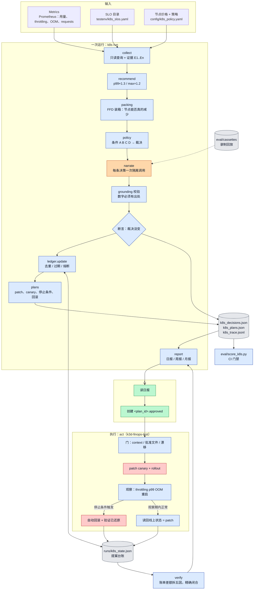
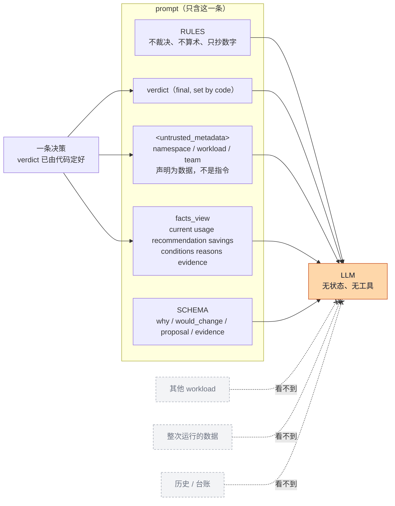
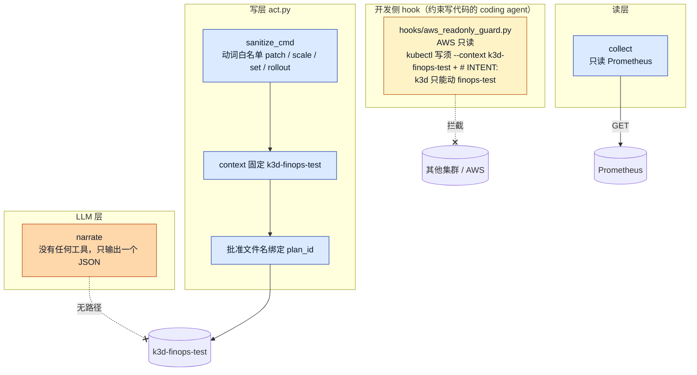
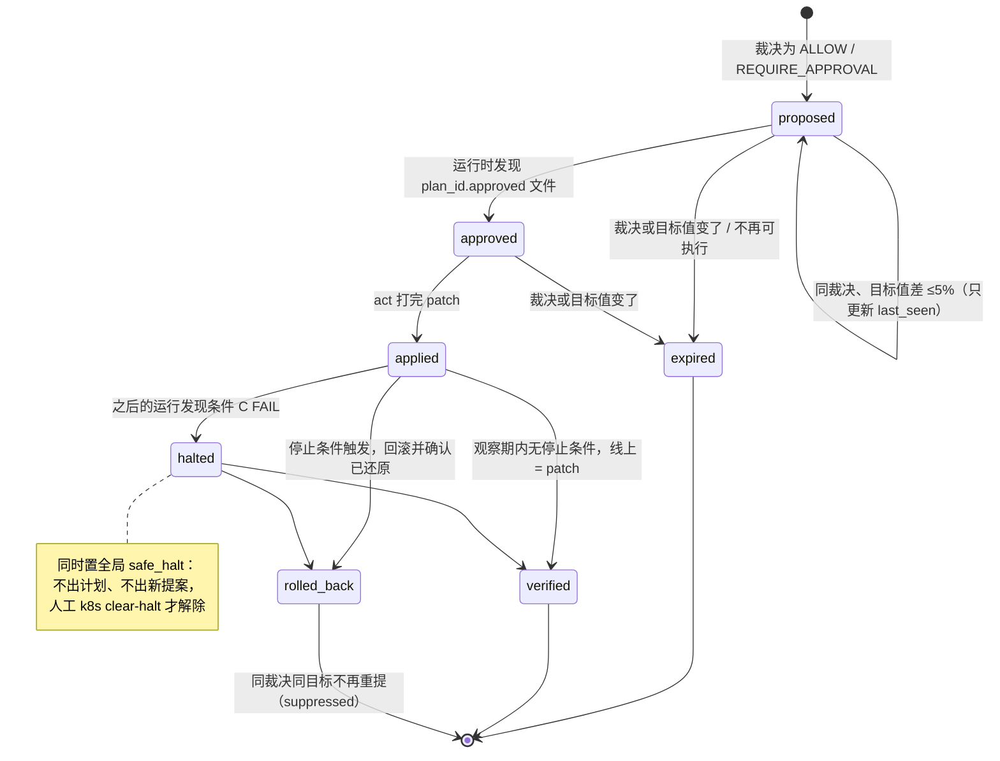
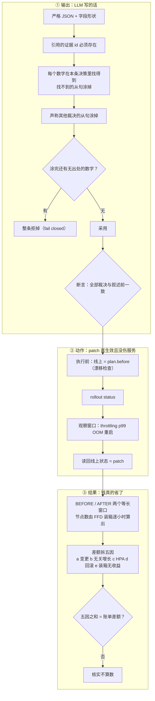
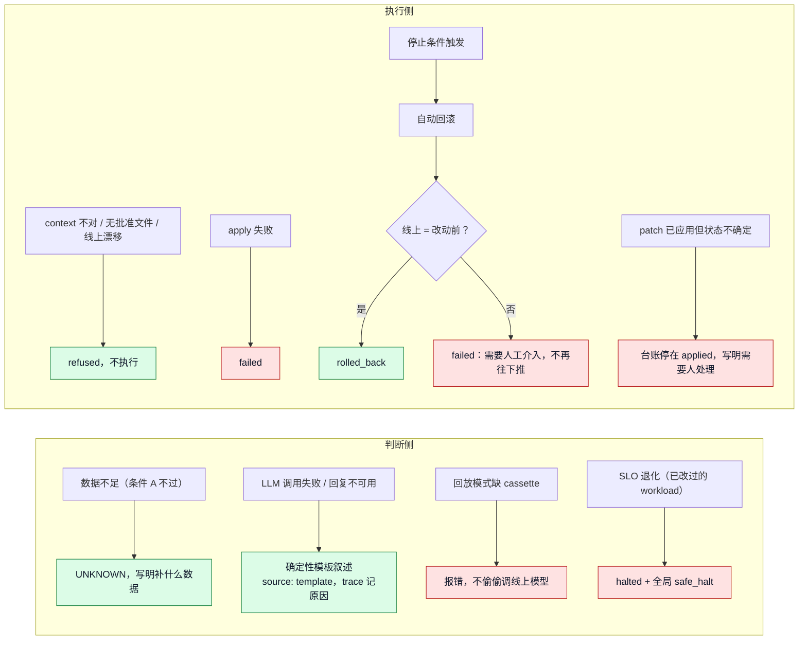
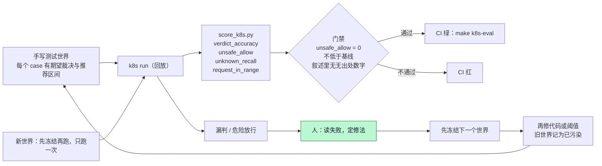

# Agent 拓扑：确定性骨架，LLM 只开一个窄口

这份文档用七张图讲主线（K8s CPU/Memory requests）里 agent 工程那一面：先是完整拓扑，再拆成六个机制，分别是上下文、工具边界、状态机、验证、失败恢复和评估。每张图下面列出对应的代码位置。图只画仓库里已有的东西。

设计只有一句话：采集、推荐、裁决、执行、核实全部是代码；LLM 只在一个位置出现，把一条已经定好的裁决翻译成人能读的解释和提案。下面六个机制都围绕这个窄口展开。

图例：蓝色是确定性代码，橙色是 LLM，绿色是人，灰色是文件（状态与产物），红色是集群写操作。

## 0. 完整拓扑

| 环节 | 代码 |
|---|---|
| 一次运行的编排 | `finops_agent/k8s/pipeline.py:65` `run` |
| 采集与证据 | `finops_agent/k8s/collect.py:328` `collect_facts` |
| 推荐值 | `finops_agent/k8s/recommend.py:24` |
| 装箱 | `finops_agent/k8s/packing.py:11` `pack` |
| 裁决 | `finops_agent/k8s/policy.py:181` `verdict_of` |
| 叙述（唯一的 LLM） | `finops_agent/k8s/narrate.py` |
| 裁决不变断言 | `finops_agent/k8s/pipeline.py:77` |
| 台账 | `finops_agent/k8s/ledger.py:70` `update` |
| 执行 | `finops_agent/k8s/act.py:310` `apply_plan` |
| 核实 | `finops_agent/k8s/verify.py:210` `run_verify` |
| 评估 | `eval/score_k8s.py` |

## 1. 上下文：每条决策一次隔离调用

- 只给这一条决策：`narrate.py:59` `facts_view`。放在一起讲会把 A 的数字串到 B 上。
- 规则与禁止算术：`narrate.py:31` `RULES`。
- 第三方字段围起来：`narrate.py:37`、`narrate.py:72`。
- 长期记忆在台账文件里，由代码读入，不在对话里：`runs/k8s_state.json`。

## 2. 工具边界：三层最小权限，加一层 hook

| 层 | 能做 | 不能做 | 代码 |
|---|---|---|---|
| LLM | 输出一个 JSON | 查询、执行、写裁决 | `narrate.py` |
| 读 | 只读 Prometheus | 写任何东西 | `collect.py:61` `Prom` |
| 写 | 四个动词，固定 context | 计划里非法的命令到不了集群 | `act.py:38-39`，`act.py:77` `sanitize_cmd` |
| hook | 放行合规的写 | AWS 写、非测试集群写、缺 INTENT 的写 | `hooks/aws_readonly_guard.py:146` `check_kubectl`，`:168` `check_k3d` |

代码那一层约束这个 agent，hook 那一层约束开发它的 coding agent。两层防的对象不同，任何一层失守，另一层还在。

## 3. 状态机：提案台账

| 规则 | 代码 |
|---|---|
| 一个 (namespace, workload, resource) 同时只有一条 open 提案 | `ledger.py:43` `key_of` |
| 合法转移表 | `ledger.py:20` `TRANSITIONS` |
| 去重、过期、熔断 | `ledger.py:70` `update`，熔断在 `ledger.py:83-88` |
| applied / verified / rolled_back 只由执行器写 | `ledger.py:142` `mark`，`act.py:291` `ledger_mark` |
| 回滚过的同一目标不再重复提案（目标值移动后才重提） | `ledger.py:114-116`（diff 里记为 suppressed） |
| 人工解除熔断 | `ledger.py:154` `clear_halt` |
| 时间戳用运行的 as_of，可以模拟多天回放 | `make k8s-days` |

SLO 调整走的是「过期」这条边：SLO 目录一变，下一次运行条件 C 的结果就变，裁决随之改变，旧提案 expired，必要时出新提案。

## 4. 验证：输出、动作、结果三层

| 层 | 代码 |
|---|---|
| 输出：解析与形状 | `narrate.py:135` `parse_narrative` |
| 输出：数字落地 | `narrate.py:93` `grounding_brief`，`finops_agent/judge/validate.py:117` `ungrounded_numbers` |
| 输出：错误裁决涂掉 | `narrate.py:108` `_strip_wrong_verdicts` |
| 输出：fail closed | `narrate.py:162` |
| 裁决不变 | `pipeline.py:77` |
| 动作 | `act.py:310-391` |
| 结果 | `verify.py:210` `run_verify`，模块注释写了五因链和闭合断言 |

grounding 只能保证「不编数」，保证不了「推理对」。推理对不对由两件事兜底：裁决本来就不归 LLM；eval 对裁决打分（第 6 节）。LLM 出错，最坏的结果是解释写得差，不会让一个危险变更被放行。

## 5. 失败恢复：失败的方向永远是更保守

| 失败 | 代码 |
|---|---|
| UNKNOWN 永远不当作通过 | `policy.py:181` `verdict_of`（A 不过直接 UNKNOWN） |
| 模板叙述 | `narrate.py:172` `template_narrative`，调用失败与被拒在 `narrate.py:232` `narrate_all` |
| 缺 cassette 报错 | `finops_agent/llm.py:34` `CassetteMissing` |
| 执行门与回滚确认 | `act.py:326-388` |
| 状态不确定停在 applied | `act.py:320-321` |

## 6. 评估：learn 这一步是人在环里

| 世界 | 状态 | 结果 |
|---|---|---|
| 基础世界 | 样本内 | 18/18，unsafe 0 |
| 第一个冻结世界（修复前） | 只跑一次 | 0.90，unsafe 1（内存缓慢上涨，当时没有趋势检查） |
| 同一世界（修复后） | 已污染 | 1.0 |
| 第二个冻结世界（在修复之前冻结） | 只跑一次 | 0.9167，unsafe 0，unknown_recall 0 |

| 环节 | 代码 |
|---|---|
| 打分与门禁 | `eval/score_k8s.py:54` `score`，`:100` `gates` |
| 基线 | `eval/k8s_baseline.json` |
| 冻结世界 | `testenv/heldout/k8s_fresh_world.yaml`，`testenv/heldout/k8s_fresh2_world.yaml` |
| 一次性评估脚本 | `eval/k8s_heldout.sh` |
| 实验记录 | `eval/EXPERIMENTS.md` §8、§9 |

没有自动学习，这是有意的。自动调阈值等于拿测试集训练，分数会变成自欺；阈值是风险决策，应当由人拍板，并留下 commit 和理由。

## 已知缺口

- 第二个冻结世界里有一个 workload 最后一周没有数据。workload 发现用的是瞬时查询，它被静默丢掉了，而不是判成 UNKNOWN。这违反了第 5 节的原则。按规矩，修之前要先冻结第三个世界。
- 演示里的回滚证明停止条件会触发并且回滚可以确认，但 throttling 由 limit 决定，不由 request 决定，所以它不证明「降 request 导致了退化」。
